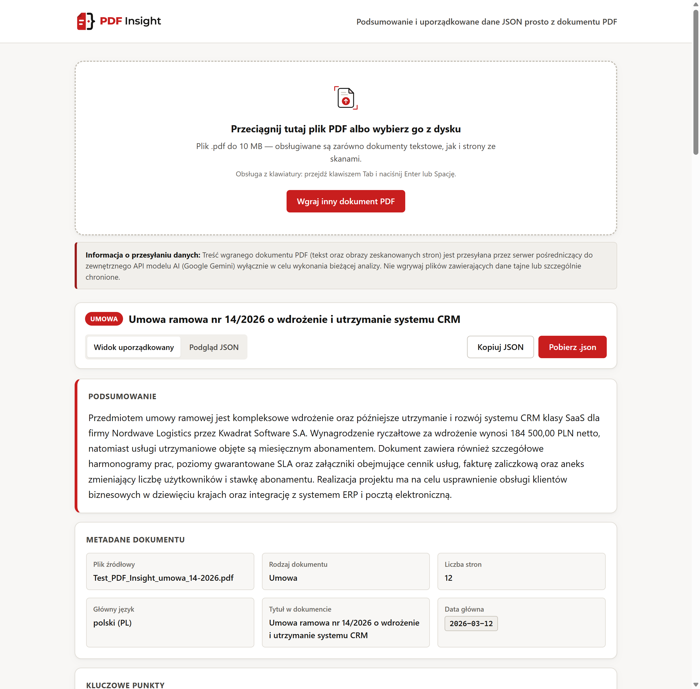
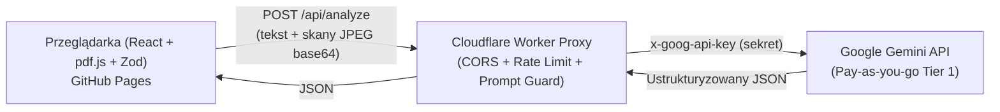

# PDF Insight

Aplikacja webowa analizująca dokumenty PDF (w tym wielostronicowe umowy oraz strony zawierające zeskanowane obrazy bez warstwy tekstowej) i zwracająca w kilkanaście sekund zwięzłe podsumowanie oraz ustrukturyzowany, zweryfikowany schematem **Zod** obiekt JSON gotowy do skopiowania lub pobrania.

👉 **Live Demo:** **[https://dagmaraozimek27.github.io/pdf-insight/](https://dagmaraozimek27.github.io/pdf-insight/)**
🔗 **API Proxy (Cloudflare Workers):** `https://pdf-insight-api.dagmara-ozimek27.workers.dev` *(chronione polityką CORS)*



---

## Spis treści

1. [Główne możliwości](#1-główne-możliwości)
2. [Architektura i bezpieczeństwo](#2-architektura-i-bezpieczeństwo)
3. [Stos technologiczny i decyzje projektowe](#3-stos-technologiczny-i-decyzje-projektowe)
4. [Uruchomienie lokalne](#4-uruchomienie-lokalne)
5. [Struktura repozytorium i AI Harness](#5-struktura-repozytorium-i-ai-harness)
6. [Znane ograniczenia](#6-znane-ograniczenia)

---

## 1. Główne możliwości

- **Wgrywanie i walidacja binarna PDF (`F-01`):** Obsługa *drag & drop*, wyboru z dysku oraz pełnej nawigacji klawiaturą (`Tab`, `Enter` / `Spacja`, wyraźny `:focus-visible`). Oprócz rozszerzenia `.pdf` i limitu do `10 MB`, aplikacja sprawdza sygnaturę binarną `%PDF-` w nagłówku pliku.
- **Ekstrakcja tekstu i obsługa skanów (`F-02`, `F-10`):** Odczyt warstwy tekstowej strona po stronie przez `pdfjs-dist`. Strony pozbawione warstwy tekstowej (np. zeskanowane załączniki i aneksy) są automatycznie wykrywane, renderowane w przeglądarce na `<canvas>` do skompresowanego obrazu JPEG i przekazywane do multimodalnego modelu wizyjnego Gemini Flash.
- **Obsługa długich dokumentów (`F-08`):** Dzielenie obszernych plików na logiczne fragmenty z zachowaniem granic stron (*chunking*) oraz scalanie wyników częściowych w jeden spójny obiekt JSON.
- **Gwarancja kontraktu danych JSON (`F-03`, `F-04`, `F-05`):**
  - walidacja każdej odpowiedzi modelu schematem **Zod** przed wyświetleniem (kody języków ISO 639-1, waluty w 3-literowym standardzie ISO 4217 wielkimi literami, daty kalendarzowe ISO 8601 `YYYY-MM-DD`, podsumowanie 3–5 zdań, 3–7 kluczowych punktów),
  - automatyczna **1 ponowna próba (`1x retry`)** z przekazaniem listy błędów walidacji Zod, jeśli pierwsza odpowiedź modelu odbiega od schematu,
  - czytelna prezentacja 7 sekcji danych, podgląd sformatowanego JSON-a z kopiowaniem do schowka oraz eksport do pliku `.insight.json`.
- **Stany interfejsu po polsku i lokalna historia (`F-06`, `F-09`):** Intuicyjny stan pusty, żywy postęp etapów przetwarzania z możliwością przerwania (`AbortController`), stan błędu z przyciskiem *„Spróbuj ponownie”* dla ostatniego pliku oraz lokalna historia do 10 analiz w `localStorage` (walidowana schematem Zod przy odczycie).
- **Responsywność i dostępność:** Pełna obsługa wąskich ekranów od `360 px` bez poziomego przewijania oraz autorskie grafiki wektorowe `.svg` zaprojektowane natywnie w Affinity.

---

## 2. Architektura i bezpieczeństwo



### Jak chroniony jest klucz API i dane?
1. **Brak sekretów na frontendzie i w Git:** Klucz `GEMINI_API_KEY` nigdy nie trafia do kodu klienckiego, zmiennych `VITE_*` ani repozytorium. Jest przechowywany wyłącznie jako zaszyfrowany sekret środowiskowy w **Cloudflare Workers** i przekazywany do Google wyłącznie w nagłówku HTTP `x-goog-api-key` (nigdy w parametrze URL).
2. **Ochrona endpointu proxy:** Cloudflare Worker weryfikuje nagłówek `Origin` (ścisła biała lista `CORS` zwracająca `403 Forbidden` dla obcych domen), egzekwuje limit rozmiaru żądania (`413` powyżej `6 MB`) oraz *rate limiting* na adres IP (`15 zapytań / min`, kod `429`).
3. **Polityka prywatności modelu (Tier 1) i jawna informacja w UI:** Strefa wgrywania wyświetla czytelną informację, że treść dokumentu trafia przez proxy do zewnętrznego API Google Gemini. Wykorzystanie planu rozliczeniowego **Pay-as-you-go (Tier 1)** gwarantuje, że przesyłane dokumenty nie są wykorzystywane przez Google do trenowania modeli.
4. **Obrona przed *Prompt Injection* oraz *XSS*:**
   - instrukcje sterujące są odseparowane w kanale `systemInstruction`, natomiast cały tekst z PDF zamykany jest w znacznikach danych `<untrusted_pdf_document>` z jawnym nakazem ignorowania ukrytych poleceń wewnątrz dokumentu i skanów (niska temperatura `0.1` + sztywny `responseSchema`),
   - w całej aplikacji obowiązuje całkowity zakaz używania `dangerouslySetInnerHTML`.

---

## 3. Stos technologiczny i decyzje projektowe

| Warstwa | Technologia | Uzasadnienie wyboru |
| :--- | :--- | :--- |
| **Frontend** | React 19, TypeScript (`strict`), Vite 6 | Szybki start statycznego SPA na GitHub Pages (0 s *cold startu*) oraz pełne bezpieczeństwo typów na etapie kompilacji. |
| **Ekstrakcja PDF** | `pdfjs-dist` + HTML5 `<canvas>` | Przetwarzanie pliku bezpośrednio w przeglądarce odciąża sieć i pozwala selektywnie renderować do JPEG wyłącznie strony zeskanowane bez tekstu. |
| **Walidacja danych** | `Zod` | Jedno źródło prawdy dla typów TypeScript, walidacji odpowiedzi AI (z generowaniem precyzyjnego feedbacku dla `1x retry`) oraz bezpiecznego odczytu z `localStorage`. |
| **Backend Proxy** | Cloudflare Workers (`workerd`) | Start poniżej `5 ms` na brzegu sieci bez usypiania kontenera (kluczowe dla utrzymania pełnej analizy poniżej `30 s`). |
| **Model AI** | Google Gemini Flash (`gemini-3.5-flash-lite` + *fallback*) | Natywna multimodalność (jednoczesna analiza tekstu i skanów JPEG), czas odpowiedzi rzędu kilku sekund oraz automatyczny *fallback* między modelami Flash przy chwilowym przeciążeniu API (`503`/`429`). |
| **Jakość i CI/CD** | Vitest, ESLint, Prettier, GitHub Actions | 37 testów jednostkowych oraz automatyczny pipeline blokujący wdrożenie w razie błędu formatowania, typów, lintera lub testów. |

---

## 4. Uruchomienie lokalne

### Wymagania wstępne
- **Node.js** `>= 20` oraz `npm`
- Klucz API Google Gemini z [Google AI Studio](https://aistudio.google.com/apikey)

### Krok po kroku

1. Sklonuj repozytorium i zainstaluj zależności:
   ```bash
   git clone https://github.com/DagmaraOzimek27/pdf-insight.git
   cd pdf-insight
   npm install
   ```

2. Skonfiguruj zmienne środowiskowe:
   - skopiuj plik przykładowy dla frontendu:
     ```bash
     cp .env.example .env
     ```
   - utwórz lokalny plik sekretów dla Cloudflare Workera (wykluczony w `.gitignore`):
     ```bash
     cp worker/.dev.vars.example worker/.dev.vars
     ```
     i wklej swój klucz w `worker/.dev.vars`:
     ```ini
     GEMINI_API_KEY=twoj_klucz_api_gemini
     ```

3. Uruchom w dwóch terminalach lokalny serwer proxy oraz frontend:
   ```bash
   # Terminal 1 — backend proxy na http://127.0.0.1:8787
   npm run worker:dev

   # Terminal 2 — frontend Vite na http://127.0.0.1:5173/pdf-insight/
   npm run dev
   ```

4. Uruchomienie pełnego zestawu bramek jakości i testów:
   ```bash
   npm run format:check
   npm run typecheck
   npm run lint
   npm run test
   npm run build
   ```

---

## 5. Struktura repozytorium i AI Harness

```text
pdf-insight/
├── .github/workflows/deploy.yml  # Pipeline CI/CD (bramki jakości + deploy na GitHub Pages)
├── docs/screenshot.png           # Zrzut ekranu działającej aplikacji
├── public/                       # Grafiki wektorowe zaprojektowane w Affinity (logo, favicon, ikona)
├── src/
│   ├── api/analyzeClient.ts      # Klient HTTP z walidacją Zod, 1x retry i scalaniem fragmentów
│   ├── components/               # Dostępne komponenty interfejsu po polsku
│   └── lib/                      # config.ts, uiCopy.ts, schema.ts, pdfValidator.ts, pdfExtractor.ts, historyStorage.ts
├── worker/
│   ├── src/config.ts             # Stałe i limity bezpieczeństwa serwera proxy
│   ├── src/index.ts              # Cloudflare Worker (CORS, Rate Limit, Prompt Injection Guard, Gemini fallback)
│   └── wrangler.toml             # Konfiguracja wdrożeniowa Cloudflare Workers
├── AGENTS.md                     # Konstytucja techniczna i twarde zakazy dla agentów AI
├── SPEC.md                       # Specyfikacja funkcjonalna F-01..F-10 i plan etapowy
└── AI_LOG.md                     # Dziennik współpracy z AI, promptów i weryfikacji człowieka
```

---

## 6. Znane ograniczenia

- **Maksymalna liczba obrazów skanów na dokument:** W celu ochrony limitów rozmiaru żądania (`6 MB`) i utrzymania czasu analizy poniżej `30 s`, do modelu wizyjnego przekazywanych jest maksymalnie `5` zeskanowanych stron bez warstwy tekstowej (`MAX_SCANNED_PAGE_IMAGES = 5`), a wieloczęściowa analiza bardzo długich dokumentów obejmuje do `6` fragmentów po `24 000` znaków (`MAX_CHUNKS_TO_ANALYZE = 6`).
- **Pliki zabezpieczone hasłem:** Zaszyfrowane pliki PDF chronione hasłem nie mogą zostać otwarte bez klucza — aplikacja wykrywa ten stan i wyświetla czytelny komunikat po polsku.
- **Rate limiting w pamięci instancji:** Licznik zapytań na IP (`15 / min`) działa w pamięci aktywnej instancji Cloudflare Workera (wystarczający dla ochrony demo; w systemie klasy enterprise można zastąpić go globalnym Cloudflare Rate Limiting Rules lub Durable Objects).
